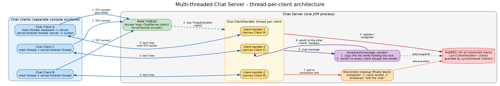

# Multi-threaded Java Chat Server

**NexLevr Java Development Internship - Task 3**
Student: Monika S. | Register No.: 111725203065 | B.Tech. Information Technology, IT-B, II Year

## Objective

Build a console-based chat application in plain Java (TCP sockets and threads) in which a server handles **many clients at the same time**, and document the **concurrency model** clearly.

> **Educational demonstration.** The chat has no authentication and no encryption and is not production-ready.

## Features

* Server with a configurable port (default `5000`).
* Any number of clients can connect simultaneously (tested with 10 at once).
* **Thread-per-client**: the main thread accepts connections, a separate `ClientHandler` thread serves each client.
* Message broadcasting: what one client types is delivered to all other clients.
* Join and leave notifications (`*** Bob joined the chat ***`).
* Graceful handling of `/quit` and of abrupt disconnections (client crash / network loss).
* Commands: `/users` (who is online) and `/quit`.
* Names are checked (1-20 characters of letters, digits, `_`, `-`) and must be unique (case-insensitive).
* Server log shows timestamps and the **thread name** that handled each event, which makes the concurrency visible during the demo.
* No external libraries; compiles with Java 8 or newer.

## Technologies

Java (`java.net.Socket`, `ServerSocket`, `Thread`, `synchronized`), Visual Studio Code, PowerShell, Git/GitHub.

## Project structure

```
MultiThreadedChatServer/
├── src/
│   ├── ChatServer.java        server: accept loop + shared client list
│   ├── ClientHandler.java     one thread per client
│   └── ChatClient.java        console client
├── test/
│   └── ChatServerTest.java    automated end-to-end tests (no framework needed)
├── docs/
│   ├── architecture.md        architecture explanation + Mermaid diagram
│   ├── concurrency-model.md   beginner-friendly concurrency documentation
│   ├── demo-script.md         step-by-step script for the screen recording
│   ├── test-plan.md           manual test plan
│   ├── images/                architecture.png / .svg / .dot / .mmd
│   ├── automated-test-output-linux-jdk21.txt   real output of the automated tests (assistant's Linux run)
│   └── sample-session-linux-jdk21.txt          real console output of a 3-client session (assistant's Linux run)
├── screenshots/
│   └── README.md              screenshot checklist (put your own screenshots here)
├── README.md
└── .gitignore
```

I kept the structure you suggested and added `test/`, `docs/images/`, `docs/demo-script.md` and `docs/test-plan.md`.

## Architecture overview



Details: [docs/architecture.md](docs/architecture.md).

## Concurrency model (summary)

* The **main thread** runs only the accept loop (`serverSocket.accept()`) and starts a new thread for every client.
* Each **client-handler thread** reads one client's messages (`readLine()` blocks only that thread).
* The shared list of connected clients is an `ArrayList` that is **only accessed inside `synchronized (clients)`** blocks.
* `broadcast()` copies the list under the lock and sends to the copy after releasing it, so there is no `ConcurrentModificationException` and one slow client cannot block joins and leaves.
* The `finally` block of every handler removes its client from the list and closes the socket, so no stale entries remain.

Full explanation: [docs/concurrency-model.md](docs/concurrency-model.md).

## Prerequisites

* A **JDK** (not only a JRE), Java 8 or newer. Check in PowerShell:

```powershell
java -version
javac -version
```

Both commands must print a version. If `javac` is "not recognized", install a JDK (for example Temurin/OpenJDK) and reopen VS Code so that the PATH is refreshed.

* Visual Studio Code (optional: the "Extension Pack for Java").

## Installation and execution (Windows, VS Code, PowerShell)

1. Open the project folder in VS Code: **File → Open Folder...** and choose `MultiThreadedChatServer` (or, in PowerShell: `cd <path>\MultiThreadedChatServer` and then `code .`).
2. Open a terminal: **Terminal → New Terminal** (it is PowerShell by default). Make sure the prompt shows the project folder.
3. Compile (creates the `out` folder automatically):

```powershell
javac -d out src\ChatServer.java src\ClientHandler.java src\ChatClient.java
```

No output means success.

4. Start the server in this terminal:

```powershell
java -cp out ChatServer
```

You should see: `Chat server started on 127.0.0.1:5000. Waiting for clients... (Ctrl+C to stop)`.

### Running multiple clients

Open one **new terminal per client** (click the `+` in the terminal panel, or use the split button). In each terminal, make sure you are in the project folder, then:

```powershell
java -cp out ChatClient Alice     # terminal 2
java -cp out ChatClient Bob       # terminal 3
java -cp out ChatClient Carol     # terminal 4
```

Type a message and press Enter to send it. Type `/users` to see who is online and `/quit` to leave.
Client syntax: `java -cp out ChatClient [name] [host] [port]` (without a name, the client asks for one).

### Changing the port

If the port is busy the server prints `Could not start the server on port 5000: Address already in use`. Either use another port (the clients must use the same one):

```powershell
java -cp out ChatServer 6000
java -cp out ChatClient Alice localhost 6000
```

or find and stop the program that uses the port:

```powershell
netstat -ano | findstr :5000
taskkill /PID <the number in the last column> /F
```

### Allowing other computers (optional)

By default the server listens on `localhost` only. To accept other computers: `java -cp out ChatServer 5000 0.0.0.0` and start the clients with the server's IP address: `java -cp out ChatClient Alice 192.168.1.20 5000`. Windows may ask for a firewall permission. Do this only on a network you trust, because the chat has no authentication or encryption.

## Sample usage

> **Illustrative output.** The following was produced by a real run of this code on Linux with OpenJDK 21 (not on a Windows laptop). Your timestamps and ports will differ. The full file is `docs/sample-session-linux-jdk21.txt`.

Server console:

```
[06:53:14] [main] Chat server started on 127.0.0.1:5055. Waiting for clients... (Ctrl+C to stop)
[06:53:15] [client-handler-1] Alice joined from /127.0.0.1:48418. Active clients: 1
[06:53:15] [client-handler-2] Bob joined from /127.0.0.1:48426. Active clients: 2
[06:53:16] [client-handler-3] Carol joined from /127.0.0.1:48432. Active clients: 3
[06:53:23] [client-handler-3] Carol disconnected. Active clients: 2
[06:53:28] [client-handler-1] Broadcast from Alice to 1 other client(s): [Alice] Alice: Bob and I are still connected
```

Bob's console:

```
Connecting to localhost:5055 ...
Welcome, Bob! Currently online: Alice, Bob
Commands: /users (list who is online), /quit (leave the chat)
*** Carol joined the chat ***
[Carol] Carol checking in
[Alice] Hello everyone, this is Alice
*** Carol left the chat ***
Online users (2): Alice, Bob
[Alice] Alice: Bob and I are still connected
```

## Testing procedure

### Automated tests

```powershell
javac -d out src\ChatServer.java src\ClientHandler.java src\ChatClient.java
javac -cp out -d out test\ChatServerTest.java
java -cp out ChatServerTest
```

The test program starts a real server on a free port, connects real TCP clients and prints `PASS`/`FAIL` for each check (single client, three clients, join notices, broadcasting, no echo to the sender, `/users`, `/quit`, abrupt disconnect, duplicate/invalid names, silent connections, 10-client stress test, server shutdown). The last line is `RESULT: <n> passed, <n> failed` and the exit code is 0 only if everything passed.

**What was actually run:** the assistant compiled the code with JDK 21 on Linux (and verified it also compiles with `--release 8`), and ran the test program there: **32 passed, 0 failed** (`docs/automated-test-output-linux-jdk21.txt`). **It has not been run on your Windows computer** - run the commands above and keep your own output as evidence.

### Manual tests

See [docs/test-plan.md](docs/test-plan.md) and the recording script in [docs/demo-script.md](docs/demo-script.md).

## Limitations

* Educational demonstration: **no authentication, no encryption**, not production-ready.
* One thread per client does not scale to very many clients.
* No limit on line length or number of clients; no message history; no private messages.
* A very slow client can delay a broadcast (the server writes to each socket directly).
* Different clients may see two simultaneous messages in a different order.
* Console windows mix incoming messages with what you are typing; that is normal for a plain console client.

## Future improvements

Thread pool (`ExecutorService`), concurrent collections, per-client outgoing queues, line-length and client-count limits, TLS and login, private messages and chat rooms, Java NIO or virtual threads. See section 10 of [docs/concurrency-model.md](docs/concurrency-model.md).

## Screenshots

Put your own screenshots in `screenshots/` (checklist in [screenshots/README.md](screenshots/README.md)):

| Placeholder | File to add |
|-------------|-------------|
| Compilation | `screenshots/01-compile.png` |
| Server running | `screenshots/02-server-started.png` |
| Three clients connected | `screenshots/04-three-clients.png` |
| Broadcast messages | `screenshots/05-broadcast.png` |
| Client disconnect | `screenshots/07-client-left.png` |

## Preparing the GitHub repository

```powershell
cd <path>\MultiThreadedChatServer
git init
git add .
git commit -m "Multi-threaded chat server: source, tests and documentation"
git branch -M main
git remote add origin https://github.com/<your-username>/MultiThreadedChatServer.git
git push -u origin main
```

Create the empty repository on github.com first (**New repository**, no README, no .gitignore, no license). `.gitignore` already excludes the `out/` folder. Add your real screenshots to `screenshots/` before the commit. Never put passwords or access tokens into the project; if Git asks you to sign in, use the browser prompt or GitHub's credential manager.
