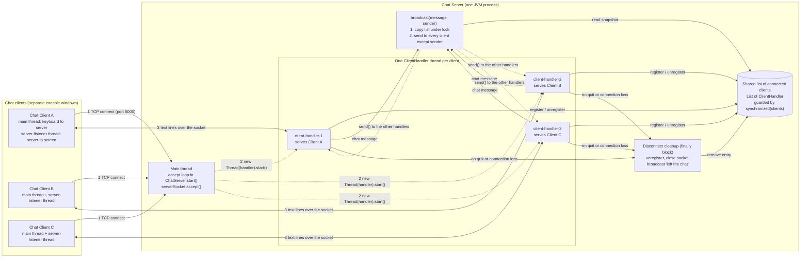

# Architecture

This document describes the architecture **as implemented** in `src/ChatServer.java`, `src/ClientHandler.java` and `src/ChatClient.java`.

## Diagram

* High-resolution PNG: `docs/images/architecture.png` (use this one in your Word report)
* Vector version: `docs/images/architecture.svg`
* Source of the PNG/SVG: `docs/images/architecture.dot` (Graphviz). Re-create the images with:
  `dot -Tpng -Gdpi=160 docs/images/architecture.dot -o docs/images/architecture.png`
* Mermaid version of the same design (renders automatically on GitHub and in the VS Code Markdown preview): see below and `docs/images/architecture.mmd`.

> Note: the PNG/SVG were drawn with Graphviz. The Mermaid block below describes the same components and message flow, but its drawing was **not** rendered when this project was prepared, so check that it displays correctly in your preview. If it does not, use the PNG.

## How to read the diagram

| Step | What happens | Where in the code |
|------|--------------|-------------------|
| 1 | A client opens a TCP connection to the server port. | `ChatClient.run()` calls `socket.connect(...)`; the server's `serverSocket.accept()` returns. |
| 2 | The **main thread** creates a `ClientHandler` for that socket and starts a new thread for it, then immediately goes back to `accept()`. | `ChatServer.start()` |
| 3 | Client and handler exchange text lines over the socket (first line = name, then chat messages and commands). | `ClientHandler.performHandshake()` and `chatLoop()`; `ChatClient.run()` and `listenToServer()` |
| 4 | The handler adds its client to the shared list after the name is accepted, and removes it when the client leaves. | `ChatServer.register()` / `unregister()` |
| 5 | A chat message read by one handler is passed to `broadcast()`. | `ClientHandler.chatLoop()` |
| 6 | `broadcast()` copies the list under the lock and calls `send()` on every other client's handler. | `ChatServer.broadcast()`, `ClientHandler.send()` |
| 7 | When a client quits or its connection breaks, the `finally` block of its handler removes it from the list, closes the socket and announces "left the chat". | `ClientHandler.run()` → `cleanup()` |

## Components

| Component | Class | Thread(s) it runs on |
|-----------|-------|----------------------|
| Chat server (accept loop) | `ChatServer` | the `main` thread |
| Client handler (one per connected client) | `ClientHandler` | its own thread, named `client-handler-N` |
| Chat client | `ChatClient` | `main` thread (keyboard → server) and a daemon thread `server-listener` (server → screen) |
| Shared collection of clients | `ChatServer.clients` (`ArrayList<ClientHandler>`) | accessed by all server threads, always inside `synchronized (clients)` |

## Wire protocol (plain text, one message per line)

1. The client sends its **name** as the first line.
2. The server answers `Welcome, <name>! Currently online: ...` or `ERROR: ...` and closes the connection if the name is invalid (1–20 characters: letters, digits, `_`, `-`) or already in use (case-insensitive).
3. After that, every line the client sends is a chat message, except the commands `/users` and `/quit`.
4. The server sends other people's messages as `[Name] text`, and notices as `*** Name joined the chat ***` / `*** Name left the chat ***`.

## Design decisions

* **Plain `java.net` sockets, no frameworks**: easy to explain and nothing to install.
* **Thread-per-client**: the simplest correct model for a small chat; see `concurrency-model.md` for its limits.
* **Server binds to `localhost` by default**: only programs on your own computer can connect, which also avoids the Windows firewall pop-up during a demo. Start the server with `0.0.0.0` as second argument to accept other computers.
